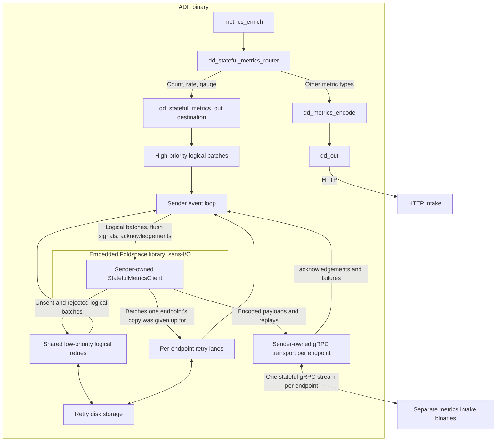

# Testing stateful metrics delivery

ADP embeds `foldspace-core` through a pinned Cargo dependency from the
[Foldspace metrics stack](https://github.com/DataDog/foldspace/pull/143). You do not copy Foldspace
source into Saluki or run a separate client binary.

Configuration selects delivery for count, rate, and gauge series. When the stateful endpoint is
configured, those series use the dedicated `dd_stateful_metrics_out` destination. Other metric types
continue through the HTTP encoder. Stream failures never switch series delivery to HTTP.



One sender task owns one core and one stream per configured endpoint. The core sends every
payload to every endpoint, sharing one dictionary across them. The transport is internal to the
destination, not a separate topology component, and never retries encoded payloads independently.

## Build and configure

Build ADP from this branch:

```sh
cargo build --bin agent-data-plane
```

Building requires `protoc` and access to the private Foldspace Git repository. Foldspace includes
its tokenizer source. The pinned Foldspace revision is recorded in the workspace manifest and
`Cargo.lock`.

For local testing, add this setting to your ADP configuration:

```yaml
data_plane:
  experimental:
    stateful_metrics:
      endpoint: http://127.0.0.1:8080
```

You can also set `DD_DATA_PLANE_EXPERIMENTAL_STATEFUL_METRICS_ENDPOINT`. The endpoint must be a plaintext HTTP
origin without a path, query, or embedded credentials. It is a startup-only setting: restart ADP to
change it. Leaving it unset preserves the existing HTTP pipeline.

To send every stateful payload to further intakes as well, list them after the primary endpoint:

```yaml
data_plane:
  experimental:
    stateful_metrics:
      endpoint: http://127.0.0.1:8080
      additional_endpoints:
        - http://127.0.0.1:8081
```

`DD_DATA_PLANE_EXPERIMENTAL_STATEFUL_METRICS_ADDITIONAL_ENDPOINTS` takes a space-separated list. Each entry follows
the primary endpoint's rules, must be distinct, and uses the primary API key. The setting requires
`data_plane.experimental.stateful_metrics.endpoint` and is startup-only.

From a Foldspace checkout at the revision pinned in `Cargo.toml`, build and run its separate
metrics intake binary, once per endpoint:

```sh
cargo build -p foldspace-grpc-server --bin foldspace-intake
INTAKE_MODE=metrics LISTEN_ADDR=127.0.0.1:8080 JOURNAL_PATH=/tmp/foldspace-metrics.jsonl \
  target/debug/foldspace-intake
```

Then, from the ADP checkout, run ADP:

```sh
target/debug/agent-data-plane --config /path/to/datadog.yaml run
```

`INTAKE_MODE=metrics` is required: the intake defaults to logs. The JSONL journal records decoded
metric series for verification. The server uses `datadog.intake.stateful.StatefulIntake/StatefulStream`, receives zstd-compressed
`MetricDatumSequence` payloads in `StatefulBatch`, and returns ordered `BatchStatus` messages.
ADP sends `dd-api-key`, `dd-content-encoding: zstd`, and `dd-state-request-bytes: 5242880` headers.

Configure the normal HTTP intake as well when testing sketches or sets. Use a dummy API
key and local HTTP intake for isolated tests. With the normal Agent connection, ADP gets the API key
from its existing configuration stream. The test-only standalone mode can also drive this pipeline.

## Delivery and retry behavior

ADP converts enriched series once to `LogicalMetricBatch` values. Rate normalization,
resources, tags, origin, source type, and unit follow the V3 encoder's semantics. Non-finite points
and empty series are excluded. The sender does not retain original ADP `Metric` objects, but each
series shares the `Tag` handles of its context instead of copying the tag strings. Interned, shared,
and inlined tags clone without copying.

The destination reuses the HTTP forwarder's `PendingTransactions<T>` scheduling and `RetryQueue<T>`
storage machinery with a distinct logical-batch entry type:

- Fresh batches enter the high-priority queue. Overflow enters the low-priority queue.
- Foldspace retries stream failures itself (see [Internal retries](#internal-retries)). Batches it
  gives up on, and unsent partial batches, enter the low-priority queue. With several endpoints,
  batches given up for one endpoint go to that endpoint's lane instead (see
  [Multiple endpoints](#multiple-endpoints)).
- High-priority work is selected first. Low-priority memory entries are read before disk entries,
  following the existing queue's preference for recent data.
- Batches removed from the queue enter the sender's current core and are encoded again with the stateful protocol. Neither the
  retry entry nor its disk representation contains stream-specific IDs or encoded wire payloads.
- Foldspace retains each sent payload, compressed, until every endpoint acknowledges it or it gives
  that endpoint's copy up. A successful channel enqueue is not a delivery acknowledgement. Lost
  acknowledgements can cause duplicates on replay or retry.

Queue capacity, memory limits, disk location, disk limits, spill ratio, and file age use the existing
forwarder settings, including `forwarder_high_prio_buffer_size`,
`forwarder_retry_queue_payloads_max_size`, `forwarder_storage_path`, and
`forwarder_storage_max_size_in_bytes`. Queue byte accounting estimates the logical data as if owned,
including series, points, tags, and resource strings. Conversion shares tags with the aggregator's
contexts instead of copying them, but queued batches keep those tags alive, so they count in full.
Queued tags also keep their DogStatsD interner entries alive. With `allow_context_heap_allocations: false`, a full interner can drop new contexts; the default permits heap fallback. This is not a total process memory bound.

Disk storage is enabled only when configured. Its directory is separate from HTTP transactions and
includes the logical format version, destination hash, and the original single-sender suffix. If requested storage cannot
be initialized, component startup fails. Overflow spills to disk; graceful shutdown flushes remaining
entries to disk. This is not a write-ahead log: a crash can lose memory-only and inflight work.
Without disk storage, overflow and shutdown can drop queued data. The process-wide shutdown timeout can interrupt delivery or persistence, so persistence is best effort within the remaining shutdown time. Queue evictions, oversized entries,
and spill failures are reported through drop accounting; a rejected entry does not stop the sender.
Shutdown persistence errors are returned to the component supervisor.

Transient failures reconnect with exponential backoff from 250 milliseconds to 30 seconds, tracked per
endpoint. The new stream assumes the intake holds no dictionary state: the core replays its retained
payloads first, then work taken from the queue is encoded against it. The core allows up to 8 payloads
inflight per endpoint, not counting definitions-only batches sent ahead of replays. A full transport
channel retains the payload and waits for capacity while continuing to receive acknowledgements. A
closed channel fails the stream, and the core keeps its payloads for replay.

Failures apply to the endpoint whose stream failed. `UNAUTHENTICATED` suspends that endpoint until the
API key changes. Credential changes replace every endpoint's stream and resume suspended endpoints.
`FAILED_PRECONDITION` and `UNIMPLEMENTED` also suspend the endpoint while retaining logical retries:
configuration does not permit automatic HTTP fallback. Correct the endpoint and restart, or reset via
a credential change. `INVALID_ARGUMENT` abandons the endpoint's outstanding and waiting payloads, which
come back under `DoNotRetry`, counts their points, and suspends the endpoint; unsent partial and queued
work remains recoverable. Invalid ACK order retains returned work and suspends the endpoint. Unsent
partial work returns to the shared queue only once every endpoint is suspended.

Opening a stream times out after 10 seconds; waiting for ACK progress times out after 30 seconds.
Streams rotate after 15 minutes and drain for up to 5 seconds. When input closes, the destination
flushes partial work and uses at most half the configured ADP stop budget (capped at 30 seconds)
waiting for delivery. This window starts when input closes, so the process-wide shutdown deadline
can still interrupt persistence; persistence is best-effort. It stops waiting once everything
deliverable is acknowledged; a suspended endpoint's lane is persisted rather than awaited. On timeout
or when every endpoint is suspended, the core gives back every payload it still retains, decoded into
logical batches, and the sender flushes the queues through their persistence path.

### Internal retries

The core keeps each payload it sends in its compressed wire form, once, with the keys of the
dictionary definitions it references, instead of the logical batch. After a retryable failure, a
drain timeout, or a credential change, it queues the endpoint's unacknowledged payloads and replays
them on the next stream ahead of newer ones, resending the same compressed bytes under new batch IDs.
Definitions a replay needs that its bytes do not carry are sent first as a definitions-only batch.
Dictionary eviction retires, rather than drops, definitions a retained payload references, so a
replay never meets a missing definition. Replays are not encoded again, and the logical batches never
pass through the retry queue.

The core gives an endpoint's copy back to the sender, decoded into the logical batch it encodes, when:

- the sender's retained compressed bytes plus retired definitions exceed
  `data_plane.experimental.stateful_metrics.retry_max_bytes` (default 8 MiB for the sender): the oldest copies still
  waiting for an endpoint, until the total fits. Copies a stream is carrying are not given up for this.
- a copy has waited for its endpoint longer than `data_plane.experimental.stateful_metrics.retry_max_age`
  (default two minutes) since its payload was encoded. The core checks age when ADP calls it,
  rather than through a dedicated expiry timer; an idle outage can delay this handoff.
- a stream ends without acknowledging a copy that was already sent
  `data_plane.experimental.stateful_metrics.retry_max_attempts` times (default 8), so a payload that keeps breaking
  streams does not loop inside the core.
- a permanent failure suspends the endpoint, or the destination shuts down.

Given-up copies take the normal path: the shared low-priority queue with one endpoint, or the
endpoint's lane with several, then `send_batch_to`, which encodes them again. Setting
`data_plane.experimental.stateful_metrics.retry_max_bytes: 0` gives every waiting copy back at once, which approximates the
previous behavior of retrying only through the queue.

With a single endpoint the core only retains what that endpoint has outstanding, at most 8 payloads,
because fresh input stays in the queue while no stream can take it. With several endpoints, a down
endpoint's copies of payloads the others carry wait in the core within these limits.

### Multiple endpoints

Foldspace sends each flushed payload to every endpoint with an open stream and room, and retains it,
compressed, until each endpoint acknowledges it or Foldspace gives that endpoint's copy up. An
endpoint that is down, draining, or full queues its copy inside the core and replays it once it can
(see [Internal retries](#internal-retries)); a suspended endpoint gets its copy back immediately.
Copies the core gives up go to a retry lane for that endpoint, and the sender resubmits them only to
that endpoint, with `send_batch_to`, once it has inflight capacity and nothing left to replay. Each
resubmission is encoded again for that endpoint alone, so it can interleave with newer payloads
there. Lanes are independent: an endpoint that cannot send never blocks retries or fresh input for
the others.

Fresh input, overflow, rejected `push_batch` submissions, and unsent partial batches stay in the shared queue,
which feeds every endpoint through `push_batch`. With one endpoint there are no lanes, and returned
batches use the shared low-priority queue as before.

Each lane is a `RetryQueue<T>` with the same spill-to-disk and drop-oldest policy. The shared
low-priority queue and every lane draw from one retry memory budget: any of them can use all of it
while the others are empty. When an entry does not fit, the sender evicts the oldest in-memory entry
across all of those queues, spilling it to disk when persistence is enabled and dropping it
otherwise, until the entry fits. A long outage on one endpoint can therefore push out older retries
for the others. The high-priority capacity stays with the shared queue and is bounded by count, not
by this budget.

The disk budget is still split evenly between the shared queue and the lanes, so with two endpoints
each of the three queues gets a third. Each persisted queue enforces its own disk limit and evicts
only its own files, so pooling disk would need shared accounting across their directories.

Before a batch enters the memory budget, the sender splits it into consecutive batches estimated at
no more than a quarter of the budget, preserving series order. A 10,000-series batch estimates about
7 MB, so with the default 15 MiB budget it becomes two entries. A single series larger than a quarter
of the budget stays whole, and an entry larger than the whole budget is dropped and counted. Each
split entry counts separately in `stateful_metrics_batches_retried_total` and
`stateful_metrics_batches_abandoned_total`; points are counted once.

Telemetry includes `stateful_metrics_batches_acked_total`, `stateful_metrics_batches_retried_total`,
`stateful_metrics_stream_failures_total`, `stateful_metrics_batches_abandoned_total`, and
`stateful_metrics_points_dropped_total`, alongside the shared priority-queue telemetry. Internal
retries report `stateful_metrics_internal_retry_retained_payloads`,
`stateful_metrics_internal_retry_retained_bytes`, and `stateful_metrics_internal_retry_pending_copies`
gauges, and `stateful_metrics_internal_retry_replays_total`,
`stateful_metrics_internal_retry_definition_batches_total`,
`stateful_metrics_internal_retry_rewrites_total`,
`stateful_metrics_internal_retry_returned_total` (tagged `reason`: `budget`, `age`, `attempts`,
`encode`, `suspension`, or `shutdown`; `encode` counts replays whose batch could not be compressed),
and `stateful_metrics_internal_retry_unreadable_total` counters. Replays
are payloads that did not have to be encoded again.

## Storage and memory

The sender uses `stateful-metrics-v1-<destination-hash>-0` beneath the configured forwarder storage root,
preserving the original single-sender namespace. With multiple endpoints, each retry lane appends
`-endpoint-<endpoint-hash>`. Reordering additional endpoints keeps their saved retries. Removing an
endpoint discards only its saved retries with a warning. Returning to one endpoint moves that
endpoint's lane into the shared queue. Changing the primary endpoint selects a different namespace.
The namespace excludes credentials, so refreshing the API key preserves retries.
Use a separate storage root for each ADP process.

Fresh batches take priority over retries. The high-priority queue is FIFO; retries can be overtaken by
fresh work. Lost acknowledgements can cause duplicates. Input order within each logical batch is preserved.

The forwarder queue capacities and disk limits apply once to the sender. Endpoint lanes share one
retry-memory budget, and divide the disk budget with the shared queue. Each endpoint has its own
transport and inflight window of eight payloads.

The sender's dictionary uses Foldspace local eviction, capped by two startup-only settings:

| Setting | Environment variable | Default |
| --- | --- | --- |
| `data_plane.experimental.stateful_metrics.dictionary_max_entries` | `DD_DATA_PLANE_EXPERIMENTAL_STATEFUL_METRICS_DICTIONARY_MAX_ENTRIES` | `60000` |
| `data_plane.experimental.stateful_metrics.dictionary_max_bytes` | `DD_DATA_PLANE_EXPERIMENTAL_STATEFUL_METRICS_DICTIONARY_MAX_BYTES` | `256MiB` (268435456) |

Both must be positive; zero, negative, and non-numeric values fail startup. The byte cap accepts a
bare byte count or a byte-size string such as `128MiB`, up to `i64::MAX`. Entries no payload has
referenced for 30 minutes are removed regardless of the caps; that interval is not configurable.

The caps are eviction targets, not reservations: the sender's dictionary grows only with the series routed
to it. The defaults cover the live working set of most nodes, so in normal operation eviction only
removes definitions for series that stopped reporting, such as departed pods. Raising the caps
costs memory only on nodes that actually have that many contexts; nodes whose working set exceeds
the caps fall back to admission control, described below. The frequency sketch starts with a
64-byte counter table and doubles as the dictionary grows, up to a size derived from both caps:
about 512 KiB at the defaults, plus bookkeeping. It does not shrink after entries leave.
Growth preserves the frequency estimates; periodic counter halving ages them with recent use.

A cap below the live working set causes more definition traffic and can slow draining under load.
Tune these limits against the sender's observed working set. For memory-constrained hosts, for example:

```yaml
data_plane:
  experimental:
    stateful_metrics:
      dictionary_max_entries: 30000
      dictionary_max_bytes: 128MiB
```

Actual heap use is higher than the estimate, which excludes allocator slack, per-endpoint sent sets,
and eviction bookkeeping such as the frequency sketch and per-entry hashes. Recently created
definitions are protected by Foldspace's 30-second grace period, so retained definitions can exceed
the caps temporarily. Transient definitions and payloads also consume memory outside these targets.

Once an eviction pass has had to relieve pressure and the dictionary is at its cap, Foldspace admits
a new or returning definition only if its frequency sketch counts it more often than the
entry it would displace. Otherwise the definition is **transient**: it is sent with the payload that
needs it but is not counted against the caps, and it is removed once no payload in progress
references it. A working set above the caps therefore costs one definition per payload that
references each value outside the retained set, rather than churning the retained set itself.

The sender reports its dictionary through these gauges:

- `stateful_metrics_dictionary_entries` and `stateful_metrics_dictionary_estimated_bytes`: retained
  definitions only, the figures the caps govern. Transient definitions are not included.
- `stateful_metrics_dictionary_transient_entries` and `stateful_metrics_dictionary_transient_bytes`:
  transient definitions, outside the caps. Sustained nonzero values mean the live working set
  exceeds the caps.
- `stateful_metrics_dictionary_frequency_sketch_bytes`: the current size of the frequency sketch,
  which grows with the dictionary up to the limit derived from the caps. It is not part of the estimate.

Closing destination input starts the sender's bounded delivery window. It then recovers remaining
logical data and flushes its retry storage. The overall process deadline can interrupt persistence;
disk flush time depends on the storage system. An event-loop error still attempts recovery and persistence.

## Flush timing

ADP owns the flush timer. The first logical batch accepted into a partial core buffer starts the
`flush_timeout_secs` countdown (default 2 seconds; zero uses 10 milliseconds). Later arrivals do not
postpone it. ADP calls `flush()` when the deadline expires or input closes. Foldspace also flushes
automatically at `max_metrics_per_payload`, which counts series rather than bytes. Empty flushes
emit nothing. Retries taken from the queue begin a new encoding attempt and get a new partial-batch deadline.
Foldspace itself reads no clock and creates no runtime task.

## Scope and validation

This is an opt-in plaintext integration experiment with one or more stateful endpoints sharing the
primary API key. HTTP `additional_endpoints` or experimental metric endpoint-routing policies select the HTTP pipeline with a warning instead of stateful delivery. Existing MRF and autoscaling-failover branches remain separate
from this primary path. TLS and proxy support remain future work.

Run focused tests with:

```sh
cargo nextest run -p agent-data-plane -p agent-data-plane-config-system -E 'test(stateful_metrics)'
```

Tests cover routing, conversion, priority scheduling, disk spill/reload, shutdown recovery, credential
refresh, timer flushing, inflight limits, failure policies, per-endpoint retry lanes and
acknowledgement deadlines, lane persistence across endpoint changes, and local gRPC exchanges. The gRPC tests
verify compression, acknowledgements, dictionary reuse, and replay of retained payloads after reconnect. For decoded-output
validation, run the separate intake process and inspect its JSONL journal.

Keep decoder tests in the separate intake process: linking `foldspace-server` into ADP's test graph
currently enables `serde_json/arbitrary_precision`, which conflicts with ADP's configuration tests.

## Repeatable binary tests

These scripts are experimental development tooling for local integration testing. They are not
part of the ADP runtime or a CI job. Their interfaces and assertions can change with the Foldspace
integration.

- [Binary harness](https://github.com/DataDog/saluki/blob/main/ci/tooling/test-stateful-metrics-binaries.py): starts the binaries, sends
  metrics, checks decoded output, and stops the processes.
- [Fault proxy](https://github.com/DataDog/saluki/blob/main/ci/tooling/stateful_metrics_proxy.py): injects connection failures and pauses
  traffic or acknowledgements to check client recovery.
- [Python requirements](https://github.com/DataDog/saluki/blob/main/ci/tooling/stateful-metrics-requirements.txt): pins the proxy's HTTP/2
  dependency.

The local harness starts actual ADP and Foldspace intake processes, sends timestamped DogStatsD
packets, and checks the intake's decoded JSONL journal. It also starts Saluki's `datadog-intake`
binary to compare the same inputs through the existing HTTP V3 route. Build the Foldspace intake
at the revision above, then run these commands from the Saluki checkout:

```sh
cargo build --locked --bin agent-data-plane --bin datadog-intake
python3 -m venv /tmp/foldspace-binary-venv
/tmp/foldspace-binary-venv/bin/python -m pip install -r ci/tooling/stateful-metrics-requirements.txt
/tmp/foldspace-binary-venv/bin/python ci/tooling/test-stateful-metrics-binaries.py \
  --adp target/debug/agent-data-plane \
  --intake /path/to/foldspace/target/debug/foldspace-intake \
  --http-intake target/debug/datadog-intake
```

Use Python 3.11 or newer and install `openssl`. The process needs permission to bind local sockets.
The HTTP comparison uses ports 2049 and 9125, which must be available; the other listeners use
automatically selected ports. All test traffic uses loopback addresses and a dummy API key.
The harness removes inherited `DD_` settings from subprocess environments.

The harness prints its artifact directory and writes `result.json`, binary hashes, configurations,
process logs, telemetry snapshots, and decoded journals. Pass `--output` with a new directory to
choose where it writes these files. Use repeated `--case` arguments to select individual cases.

| Case | Verification |
|------|--------------|
| `timer_and_metadata` | Sparse timer flushing, values, timestamps, tags, resources, origin, dictionary reuse, and ACK counters surviving idle periods. |
| `http_comparison` | Six points match HTTP V3 after normalization of batching and ordering: names, tags, host, type, interval, timestamp, and value. |
| `threshold` | Two series flush before a 60-second timer when the threshold is two. |
| `shutdown` | A partial batch reaches the intake after SIGTERM, and ADP exits successfully. |
| `reconnect` | Delivery resumes after stopping and restarting the separate intake process. |
| `disk_restart` | Shutdown during an intake outage persists logical retries; a new ADP process delivers them. |
| `rejected_stream` | Injected gRPC `UNAVAILABLE` on stream opening retains work and reconnects. |
| `lost_ack` | Withholding an ACK and disconnecting triggers replay, including the expected duplicate. |
| `stalled_reads` | Paused intake consumption retains 600 points and delivers them after consumption resumes. |
| `ack_timeout` | Withheld acknowledgements trigger ADP's 30-second deadline and replay on a new stream. |
| `sustained_load` | 30,000 points at a target 1,000 points per second, with a 12-second consumption pause, drain without loss or duplicates. |

Fault cases use a local proxy. Healthy connections relay bytes to the separate Foldspace intake;
the proxy can reject stream openings, pause reads or responses, and disconnect sockets. These cases
test ADP's response to failures. They do not reproduce a production metrics server's load-shedding
algorithm. The load case samples process memory, CPU, queue entries, acknowledgements, failures, and drops; a
short run with debug binaries is not a throughput benchmark or evidence of a hard memory bound.

The HTTP decoder's comparison model preserves host, tags, types, intervals, and points but omits
other resource and origin fields. Those fields have explicit expectations in `timer_and_metadata`.
Retries can duplicate points after a lost ACK; the two ACK-failure cases check that behavior explicitly.
The remaining stateful cases also check that series never reach the HTTP receiver.
